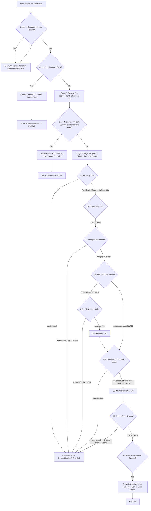

# Engineering Approach & Architecture Document
## Pre-Approved Loan Against Property (LAP) AI Voice Agent
**Candidate Role**: AI Intern / Prompt Engineer  
**Organization / Case**: SalesAgents AI & Home Credit  
**Target Domain**: Outbound Conversational Voice AI, Financial Services & Credit Verification  

---

## 1. Executive Summary & Problem Formulation

### 1.1 Objective
The business objective is to deploy an outbound, conversational Voice AI Agent for Home Credit that reaches out to existing loyal customers, presents a pre-approved Loan Against Property (LAP) offer up to ₹75,00,000 (₹75 Lakhs), evaluates **7 sequential eligibility parameters**, maintains rigorous conversation state management, executes real-time branching (immediate disqualification vs. loan balance transfer vs. busy scheduling), and gracefully hands over qualified leads to a Senior Loan Expert.

### 1.2 Core Engineering Challenges
1. **Stateful Conversation in a Stateless Voice Pipeline**: In spoken voice calls, customers speak non-linearly, supply multiple pieces of data in a single turn, correct themselves mid-sentence ("10 years... actually 12"), or interject questions.
2. **Strict Rule Enforcement Without Sounding Like an IVR**: Traditional bots fall into rigid "Yes/No" traps or interrogate users sequentially. The agent must sound like an empathetic financial advisor while enforcing 7 hard compliance gates.
3. **The "Extract First, Validate Second, Update State Third, Ask First Missing Question Fourth" (EVUA) Pattern**: The prompt must systematically guide the LLM to inspect previous turns, update the mental state, and ask only for the earliest uncaptured variable.
4. **Latency & Voice Cadence Optimization**: Spoken phone turns must stay between 1–3 short sentences (<40 words) to prevent TTS latency buffering and user fatigue.

---

## 2. Five-Layer Architecture

```
                    AI VOICE AGENT
                          │
          ┌───────────────┴───────────────┐
          │                               │
   Conversation Layer               Business Logic Layer
          │                               │
 Greeting → Offer → Questions       7 Eligibility Rules
          │                               │
          └───────────────┬───────────────┘
                          │
                   State / Memory Engine
                          │
            ┌─────────────┴─────────────┐
            │                           │
     Customer Answers             Diversions / Interruptions
            │                           │
            └─────────────┬─────────────┘
                          │
                     Final Decision Gate
                          │
             ┌────────────┴────────────┐
             │                         │
          Eligible                 Not Eligible / Transfer
             │                         │
        Human Handoff               Polite Termination
```

1. **Conversation Layer**: Formulates natural, conversational spoken utterances with empathetic tone and strict adherence to `{{agent_gender}}` and `{{language_to_speak}}`.
2. **Business Logic Layer**: Evaluates strict criteria (allowed property types, documents, tenure boundaries, income mode).
3. **State & Memory Layer**: Tracks a 7-parameter qualification dictionary plus caller verification and branch flags.
4. **Dialogue Flow Engine**: Implements the EVUA algorithm for dynamic out-of-order extraction and diversion recovery.
5. **Decision & Routing Gate**: Routes callers to Senior Loan Expert, Loan Transfer Specialist, Callback Rescheduler, or Polite Disqualification Closure.

---

## 3. Conversational State Machine & Decision Tree



---

## 4. The 7 Eligibility Rules & Validation Matrix

| # | Parameter | Target Field | Permitted / Eligible Values | Disqualifying Criteria | Action on Violation |
|---|---|---|---|---|---|
| 1 | **Property Type** | `property_type` | `Residential`, `Commercial`, `Industrial` | `Agricultural` / Farm Land | **Immediate Termination**: Explain offer scope excludes agricultural land; close call without asking remaining questions. |
| 2 | **Ownership** | `ownership_status` | `Sole Ownership`, `Joint Ownership` | None (Both are 100% eligible) | Continue to next unasked item. |
| 3 | **Documents** | `documents_available` | Original physical title deeds available for verification | Photocopies only, missing originals, disputed documents | **Immediate Termination**: Explain regulatory requirement for original physical deeds; close call politely. |
| 4 | **Loan Amount** | `loan_amount` | Up to `₹75,00,000` (₹75 Lakhs) | > ₹75 Lakhs (without agreement to counter-offer) | **Counter-Offer Protocol**: Explain ₹75L cap. Offer ₹75L option. If customer accepts, proceed with ₹75L; if customer declines, close call. |
| 5 | **Occupation + Income** | `occupation`, `income_mode` | `Salaried` OR `Self-Employed` AND received via `Bank Credit / Cheque` | `Cash Income` | **Immediate Termination**: Explain credit guidelines mandate verifiable bank deposits; close call politely. |
| 6 | **Market Value** | `market_value` | Any positive estimated valuation (e.g. ₹50L, ₹1.5 Cr) | **None**: No minimum threshold specified | Capture into state. **Do not invent arbitrary minimum cutoffs**. |
| 7 | **Tenure** | `tenure` | Between **3 and 15 years** (inclusive) | `< 3 years` (e.g., 1-2 yrs) OR `> 15 years` (e.g., 20-25 yrs) | **Immediate Termination**: Explain policy limits tenure between 3 and 15 years; close call politely. |

---

## 5. Non-Linearity & Edge Case Engineering

### 5.1 Out-of-Order Multi-Variable Utterances
*Scenario*: Customer replies to Q1 with:  
> *"It's a residential apartment in Mumbai, co-owned with my wife, value is roughly 90 lakhs, and I need 50 lakhs."*

*System Action*:
1. `property_type` = `Residential` (PASS)
2. `ownership_status` = `Joint` (PASS)
3. `market_value` = `₹90,00,000` (PASS)
4. `loan_amount` = `₹50,00,000` (PASS)
5. Missing check evaluation: Evaluates Checklist [1, 2, 3, 4, 5, 6, 7]. #1, #2, #4, #6 are filled.
6. The earliest missing index is **#3 (`documents_available`)**.
7. Spoken Output:
   > *"Understood! And do you have the original title deeds and property documents readily available for physical verification?"*

### 5.2 Speech Corrections & Temporal Updates
*Scenario*: Customer states:  
> *"I'd like a 10-year repayment tenure... wait, actually let's make that 12 years so my EMI stays lower."*

*System Action*:
The EVUA parser applies the **Latest Valid Assertion Rule**. The value `12 years` overwrites `10 years`. Since 12 years is between 3 and 15, it passes.

### 5.3 Customer Interruptions & Diversions
*Scenario*: Customer interrupts:  
> *"Hold on, what is the exact interest rate you are charging?"*

*System Action*:
1. The agent avoids the fatal trap of hallucinating rates (e.g., "Our rate is 8.5%").
2. The agent explains that interest rates are personalized based on collateral assessment by the Senior Loan Expert.
3. The agent loops back smoothly to the first missing question.
> *"Our interest rates are tailored to your profile and property assessment. Our Senior Loan Expert will calculate your exact rate and monthly EMI immediately after this quick check. Could you tell me..."*

### 5.4 Existing Loan & EMI Transfer Branching
*Scenario*: Customer states:  
> *"I already took a loan on this flat 3 years ago and I want to reduce my EMI."*

*System Action*:
The agent immediately identifies this as an **Existing Loan / Balance Transfer** intent. It does NOT proceed with Questions 1–7. It routes to the Loan Transfer Specialist and concludes the call.

---

## 6. Prompt Engineering Variable Bindings

The prompt dynamically supports platform-provided variables:
- `{{company_name}}`: "Home Credit"
- `{{customer_name}}`: Dynamic customer lead name (e.g., "Rahul Sharma")
- `{{agent_name}}`: Voice persona identifier (e.g., "Priya" or "Rohan")
- `{{agent_gender}}`: "Female" or "Male" (adheres strictly to grammatical gender in Hindi/English)
- `{{current_date}}`, `{{current_day}}`, `{{current_time}}`: For context-aware greetings ("Good morning", "Good afternoon")
- `{{language_to_speak}}`: English, Hindi, or Hinglish
- `{{additional_context_from_rag}}`: Dynamic product/branch knowledge injection
- `{{conversation_history}}`: Complete turn history
- `{{customer_utterance}}`: Real-time user input

---

## 7. Testing & Verification Matrix (14 Scenarios)

| # | Scenario Name | Test Input Summary | Expected System Behavior | Decision Gate |
|---|---|---|---|---|
| **1** | **Happy Path: Eligible Lead** | Res, Sole, Orig Docs, 50L, Salaried, Bank, 1.2Cr, 10Y | Collects all 7, passes all criteria | **QUALIFIED_HANDOFF** |
| **2** | **Disqualification: Agricultural** | Property = Agricultural land | Disqualifies on Q1, terminates call | **DISQUALIFIED** |
| **3** | **Disqualification: Cash Income** | Self-employed, Cash income | Disqualifies on Q5, terminates call | **DISQUALIFIED** |
| **4** | **Disqualification: Photocopies** | Original docs unavailable (photocopies only) | Disqualifies on Q3, terminates call | **DISQUALIFIED** |
| **5** | **Tenure Boundary: Too Short** | Desired tenure = 2 years (< 3 yrs) | Disqualifies on Q7, terminates call | **DISQUALIFIED** |
| **6** | **Tenure Boundary: Too Long** | Desired tenure = 20 years (> 15 yrs) | Disqualifies on Q7, terminates call | **DISQUALIFIED** |
| **7** | **Loan > 75L: Customer Accepts** | Desired 90L -> Counter 75L accepted | Sets 75L, continues checklist | **QUALIFIED_HANDOFF** |
| **8** | **Loan > 75L: Customer Declines** | Desired 1.2Cr -> Rejects 75L cap | Explains limit, terminates call | **DISQUALIFIED** |
| **9** | **Existing Mortgage Transfer** | Customer already has active loan on property | Routes to Transfer Specialist, skips Q1-7 | **TRANSFER_SPECIALIST** |
| **10** | **EMI Reduction Intent** | Wants lower EMI on existing property debt | Routes to Transfer Specialist, skips Q1-7 | **TRANSFER_SPECIALIST** |
| **11** | **Out-of-Order Multi-Variable** | Res, Joint, Value 1Cr, Need 45L all in Turn 1 | Parses all 4, asks Q3 (Documents) next | **QUALIFIED_HANDOFF** |
| **12** | **Busy Customer Gate** | "I'm in a meeting right now" | Asks callback time, schedules, ends call | **CALLBACK_SCHEDULED** |
| **13** | **Diversion: Rate Inquiry** | "What interest rate are you giving?" | Defers to Loan Expert, pivots to missing Q | **DIVERT_AND_RESUME** |
| **14** | **Speech Correction & Fillers** | "Umm... 10 years, wait no, 12 years" | Sets tenure to 12 years, completes flow | **QUALIFIED_HANDOFF** |

---

## 8. Deployment & Platform Integration Guide

This prompt is fully compatible with modern voice orchestration stacks:
- **Retell AI**: Paste `SYSTEM_PROMPT.txt` into the Agent Prompt. Bind custom variables (`customer_name`, `company_name`, etc.) in the LLM parameters. Enable speech-to-speech or Deepgram Nova-2 + ElevenLabs Turbo v2.
- **Bolna**: Configure state machine nodes with prompt guardrails and webhook callbacks.
- **Custom Web Voice Simulator**: Embedded inside this repository (`npm run dev`) featuring realistic audio synthesis, microphone voice input, real-time visual HUD, and automated scenario player.
